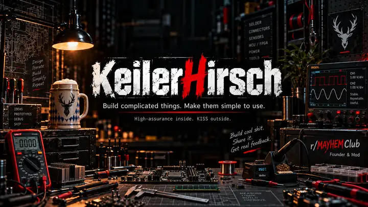
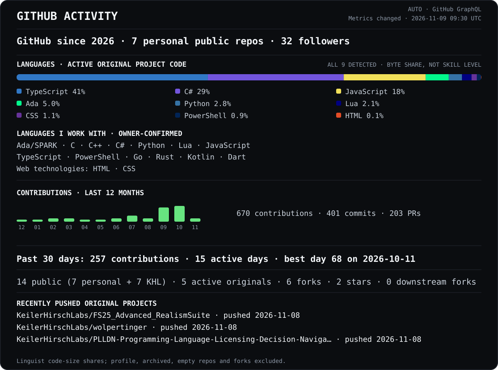

# KeilerHirsch Labs

**Simple products. Serious engineering underneath.**

Independent software engineering · deterministic systems · security research · reproducible evidence

[Projects](#projects) · [Activity](#activity) · [Engineering](#how-i-build) · [Community](#mayhem-club)

[MyRank](https://myrank.dev/u/KeilerHirsch) · [MAYHEM Club](https://www.reddit.com/r/MAYHEMClub/) · [Support on Ko-fi](https://ko-fi.com/keilerhirsch)

## Projects

**Original projects, not forks.** The maturity labels below describe what is available *now*, not the entire roadmap.

### Featured

- **[Advanced Realism Suite (ARS)](https://github.com/KeilerHirsch/FS25_Advanced_RealismSuite)** — Farming Simulator 25 realism project combining vehicle physics with a broader mechanical-systems vision. **Physics Beta published; full suite in development.** [Releases](https://github.com/KeilerHirsch/FS25_Advanced_RealismSuite/releases)
- **[PLLDN — Programming Language & Licensing Decision Navigator](https://github.com/KeilerHirsch/PLLDN-Programming-Language-Licensing-Decision-Navigator)** — browser-based, evidence-aware comparisons of programming languages and software licences. **Preview; coverage is deliberately limited and labelled.** [Use the web app](https://keilerhirsch.github.io/PLLDN-Programming-Language-Licensing-Decision-Navigator/)
- **[WOLPERTINGER](https://github.com/KeilerHirsch/wolpertinger)** — local-first Elite Dangerous companion with a deterministic journal-processing foundation. **Pre-alpha; no supported end-user release yet.** [Project site](https://keilerhirsch.github.io/wolpertinger/)

### Research & experiments

- **[SCUM-SENF](https://github.com/KeilerHirsch/SCUM-SENF)** — SCUM server observability and notifications. **Research stage; no production release.**
- **[Critical FAR Disclosure](https://github.com/KeilerHirsch/Critical-FAR-Disclosure)** — evidence-oriented security disclosure and remediation records. **Research/documentation**, not a shipped software product.

<strong>Forks & upstream projects</strong> — separate from original work

These are **forks of other maintainers' repositories**, not projects originally created by KeilerHirsch. Upstream ownership and the original projects' licences remain with their respective maintainers.

- [MemPalace fork](https://github.com/KeilerHirsch/mempalace) — upstream: [MemPalace/mempalace](https://github.com/MemPalace/mempalace).
- [TrimatikLogger fork](https://github.com/KeilerHirsch/TrimatikLogger) — upstream: [cenders77/TrimatikLogger](https://github.com/cenders77/TrimatikLogger).
- [MoreRealistic FS25 fork](https://github.com/KeilerHirsch/MoreRealistic_FS25) — upstream: [quadural/MoreRealistic_FS25](https://github.com/quadural/MoreRealistic_FS25).
- [Realistic Mechanical Systems FS25 fork](https://github.com/KeilerHirsch/FS25_RealisticMechanicalSystems) — upstream: [Squallqt/FS25_RealisticMechanicalSystems](https://github.com/Squallqt/FS25_RealisticMechanicalSystems).
- [AutoDrive FS25 fork](https://github.com/KeilerHirsch/FS25_AutoDrive) — upstream: [Stephan-S/FS25_AutoDrive](https://github.com/Stephan-S/FS25_AutoDrive).
- [Courseplay FS25 fork](https://github.com/KeilerHirsch/Courseplay_FS25) — upstream: [Courseplay/Courseplay_FS25](https://github.com/Courseplay/Courseplay_FS25).

Forking or studying a repository is **not** a claim of authorship, endorsement or an accepted upstream contribution. See each repository's actual history for changes and pull requests.

## Activity

Generated from GitHub account metrics and code-size estimates for public original repositories. Forks are counted separately; the language chart does not claim to list every language I use. Activity is not evidence of product maturity or test coverage.

## How I build

- **Evidence before claims.** Reproducible tests, provenance and observable outcomes matter more than impressive status labels.
- **KISS at the surface.** The user experience should stay simple; stronger assurance belongs at boundaries where it pays off.
- **Determinism where it matters.** Prefer explicit state, rules and verifiable sources over unexplained decisions.
- **Engineering over theatre.** Use the language, architecture and checks the actual problem warrants.

## Engineering DNA

My background combines precision mechanics, industrial electronics and applied systems work with largely self-taught software engineering. I work across Ada/SPARK, C#, Python and other technologies when appropriate; the toolchain serves the problem, not the other way around.

<strong>Background & qualifications</strong>

- **Precision Mechanic** (`Feinwerkmechaniker`) — completed German vocational qualification.
- **Electronics Technician for Industrial Engineering** (`Elektroniker für Betriebstechnik`) — completed German IHK vocational qualification.
- **State-Certified Technician program in Mechanical Engineering — Aircraft Technology specialization** — Technische Fachschule Heinze, Hamburg; **13 of 24 full-time months completed; no qualification awarded**.
- **23 months of voluntary military service** in the German Armed Forces (`Bundeswehr`).
- **Autodidact by habit** — software/systems engineering, cybersecurity research, digital forensics, OSINT and AI-assisted development.
- **Languages:** Polish · German · English.

That background shaped a simple habit: look for tolerances, failure modes, measurable behavior and maintainability before celebrating an elegant abstraction.

## Security & forensics

Security research, OSINT and digital forensics follow the same discipline as engineering: preserve evidence, separate observations from interpretations, and make claims traceable. Research repositories are **not** claims that findings or vulnerabilities have been independently verified or remediated.

## MAYHEM Club

I founded and moderate [r/MAYHEMClub](https://www.reddit.com/r/MAYHEMClub/), a space for independent developers, modders and open-source builders to share work and get practical feedback.

**Build cool shit. Share it. Get real feedback.**

## Licence

Repository-controlled automation software — including `tools/`, `tests/` and project-controlled workflow logic — is available under the [PolyForm Noncommercial License 1.0.0](LICENSE).

Profile prose, personal branding and visual assets are **not** covered by that software licence unless explicitly stated otherwise. Third-party projects and linked content retain their own rights.

---

*If the UI looks simple, someone probably suffered in the architecture first.*

<!--
🥚 You looked behind the curtain.
The Man, The Myth, The Legend.
— KeilerHirsch
-->
