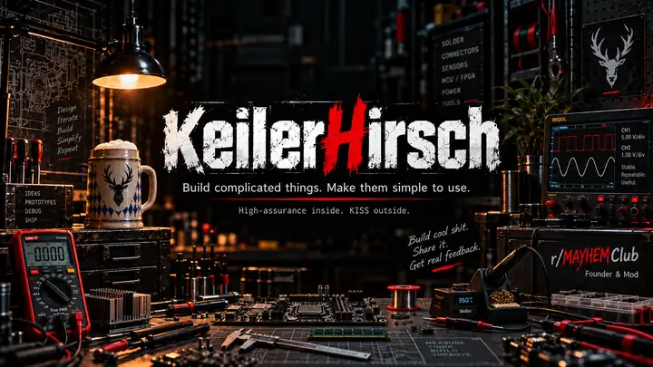
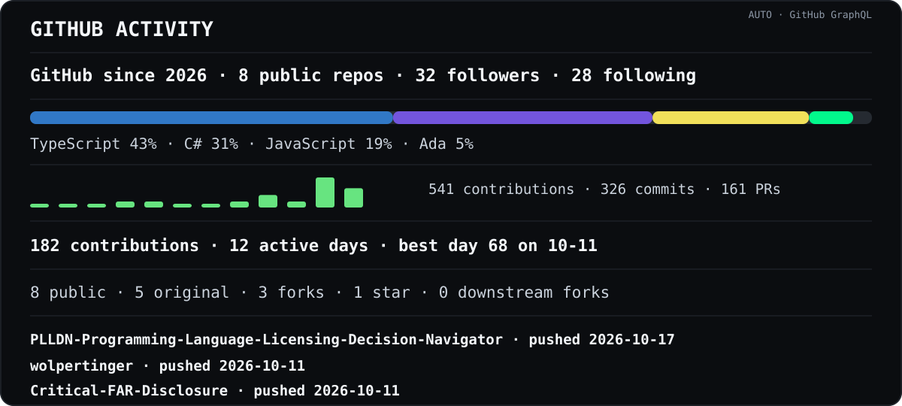

**Simple products. Uncomfortably serious engineering underneath.**

High-assurance software · security research · deterministic systems · reproducible evidence

[MyRank](https://myrank.dev/u/KeilerHirsch) · [MAYHEM Club](https://www.reddit.com/r/MAYHEMClub/) · [Ko-fi](https://ko-fi.com/keilerhirsch)

## Activity

*The workshop moves; this panel follows it automatically — repositories, languages and public activity included.*

## Featured projects

The best way to understand my work is to inspect what is built, how it is tested, and what is still missing.

| Project | What it does | Current status |
|---|---|---|
| **[Advanced Realms Suite (ARS)](https://github.com/KeilerHirsch/FS25_Advanced_RealmsSuite)** | An interconnected realism and machinery-systems suite for Farming Simulator 25: physics, wear, breakdowns, maintenance and workshops, developed as original GIANTS-native code. **[Live roadmap](https://github.com/KeilerHirsch/FS25_Advanced_RealmsSuite/blob/main/docs/ROADMAP.md)** · **[Community credits](https://github.com/KeilerHirsch/FS25_Advanced_RealmsSuite/blob/main/docs/HALL_OF_HEROES.md)** | Active development; no public release or claim of replacing ADS, Courseplay or AutoDrive |
| **[PLLDN](https://github.com/KeilerHirsch/PLLDN-Programming-Language-Licensing-Decision-Navigator)** | Browser-based programming-language and software-licence decision guide with traceable evidence. **[Try the web app](https://keilerhirsch.github.io/PLLDN-Programming-Language-Licensing-Decision-Navigator/)** | Public interactive tool |
| **[WOLPERTINGER](https://github.com/KeilerHirsch/wolpertinger)** | Local-first Elite Dangerous companion built around deterministic game-state processing. **[Project site](https://keilerhirsch.github.io/wolpertinger/)** | Pre-alpha; commander-facing UI in development |

**More from the workshop:** [SCUM-SENF](https://github.com/KeilerHirsch/SCUM-SENF) (server observability, research stage) · [GRANITProtokoll](https://github.com/KeilerHirsch/GRANITProtokoll) (engineering provenance) · [All repositories](https://github.com/KeilerHirsch?tab=repositories)

Interested in collaborating, testing or comparing approaches? Start with a project's README, open issues or discussions. Work-in-progress status is intentional; release claims require evidence.

## How I build

- **Evidence before claims.** Tests, provenance and reproducible artifacts should support what a README says.
- **Over State of the Art by default.** “Good enough” is a release decision, not an engineering philosophy.
- **Deterministic where it matters.** Core decisions should come from explicit rules and traceable facts whenever possible.
- **KISS outside. Assurance inside.** Complexity belongs behind the user-facing surface; critical boundaries get stronger assurance when the architecture benefits from it.

*If the UI looks simple, someone probably suffered in the architecture first.*

## Engineering DNA

**Ada/SPARK is my primary engineering language.** I use it where correctness matters enough to justify stronger guarantees — not because every component needs SPARK, and not because language byte counts define architectural importance.

**I would rather prove an invariant than explain later why “that should never happen” happened.**

I still use C#, Python, JavaScript and whatever else fits the job. Critical correctness is simply not where I like to negotiate.

I came to software from the physical world: precision mechanics, industrial electronics, aircraft-technology studies, military service and a suspicious amount of self-teaching. That background shaped how I approach software: **tolerances, measurements, failure modes, maintainability and systems first — syntax second.**

- **Precision Mechanic** (`Feinwerkmechaniker`) — completed German vocational qualification.
- **Electronics Technician for Industrial Engineering** (`Elektroniker für Betriebstechnik`) — completed German IHK vocational qualification.
- **State-Certified Technician program in Mechanical Engineering — Aircraft Technology specialization** (`Technikerlehrgang Maschinenbau, Schwerpunkt Luftfahrzeugtechnik`) — Technische Fachschule Heinze, Hamburg; **13 of 24 full-time months completed; no qualification awarded**.
- **23 months of voluntary military service** in the German Armed Forces (`Bundeswehr`).
- **Autodidact by habit** — largely self-taught in software engineering, security research, digital forensics, OSINT and systems work.
- **Languages:** Polish (native) · German (fluent / native-level) · English (very good).

*Formal education helped. So did a suspicious amount of self-teaching — and, apparently, 9th-grade Realschule Technik-AG.*

**GitHub is where the workshop became software — and the measurements stayed.**

## Security & forensics

I approach systems with the same mindset I use to build them: preserve evidence, bind claims to sources, separate observation from inference, and make important state reproducible.

**Focus:** AI systems · agent tooling · digital forensics · OSINT · provenance

## MAYHEM Club

I am the **Founder & Mod** of [r/MAYHEMClub](https://www.reddit.com/r/MAYHEMClub/), a creator-first workshop for indie devs, modders, open-source builders and people shipping wonderfully weird things.

**Build cool shit. Share it. Get real feedback.**

## Licence

Repository-controlled automation software — including `tools/`, `tests/` and project-controlled workflow logic — is available under the [PolyForm Noncommercial License 1.0.0](LICENSE).

Profile prose, personal branding and visual assets are **not** covered by that software licence unless explicitly stated otherwise. Third-party names, links and public GitHub data retain their own rights.

---

**Simple outside. Technically unpleasant to copy inside. 😎**

<!--
🥚 You looked behind the curtain.

The Man, The Myth, The Legend.
— KeilerHirsch

The UI was the easy part.
-->
